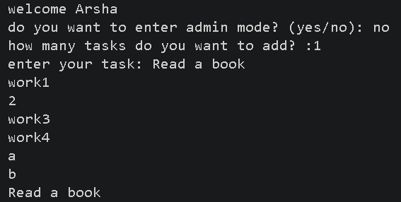
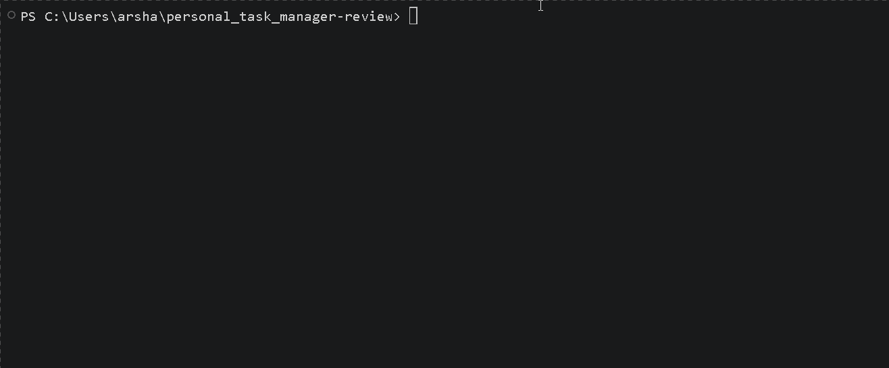

# Personal Task Manager


A simple task manager built with python

## Features
- add multiple tasks
- save tasks
- load saved tasks
- admin mode
  
## Requirments
- python
- python-dotenv

## Project Structure
```text
personal_task_manager-review/
│   .env.example
│   .gitignore
│   main.py
│   README.md
│   requirments.txt
│   tasks.py
│
├───images/
│       Animation.gif
│       screenshot.png
```

## Instalation
Install the required packages
```bash
python -m pip install requirments.txt
```
## Enviroment setup
create a `.env` file in the project folder

Use `.env.example` as a template

Add your admin password

```env
admin_pass=your_password_here
```
Replace `your_password_here` with your own admin password

## Run The Program
Run the main file:
```bash
python main.py
```
## Screenshot


## Demo

